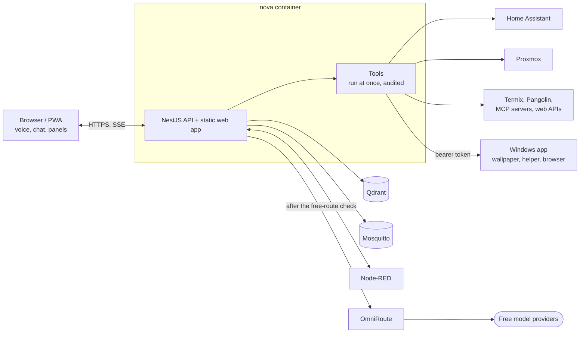

<div align="center">

# NOVA

**A self-hosted AI assistant for your home and your servers.**<br>
Talk to it, watch your infrastructure, and let it act for you. It acts first and reports afterwards.

[](https://github.com/hjongedijk/nova/actions/workflows/ci.yml)
[](https://github.com/hjongedijk/nova/releases)
[](LICENSE)


</div>

NOVA is a living interface: a particle sphere with side panels that you speak to ("Hey NOVA") or type to. It shows your servers, smart home and the world around you, answers with streaming text and a spoken voice, and uses tools to do things at once, without asking first. It runs as **one Docker image** next to the services it uses, and it only talks to language models through a **verified free route**.

> The interface and the spoken voice are Dutch. Code, model-facing tool descriptions and all documentation are English. Settings labels are quoted in Dutch in the docs, for example "Instellingen" (settings).

## Highlights

|                                   |                                                                                                                                                                                         |
| --------------------------------- | --------------------------------------------------------------------------------------------------------------------------------------------------------------------------------------- |
| **Voice and chat**                | "Hey NOVA", hold F8, tap the sphere or type. Streaming answers, a neural Dutch voice you can tune, hands-free conversations, and phone calls through your own Asterisk.                 |
| **Tools, unrestricted**           | Around a hundred tools. NOVA runs them at once and reports afterwards; there are no approval prompts. Everything is audited, and secrets are masked.                                    |
| **Free models, fail-closed**      | All model traffic goes through [OmniRoute](https://github.com/diegosouzapw/OmniRoute). Before every request NOVA verifies the route is a verified free one, otherwise it sends nothing. |
| **Memory that you control**       | Short-term context, long-term memory in Qdrant (or OmniRoute), private notes and a document library. NOVA remembers only what you ask it to, and never credentials.                     |
| **A dashboard around the sphere** | This server, Proxmox VMs and storage, weather, air quality, smart home, markets, news, timers and lists. Choose the panels and add your own.                                            |
| **Home and servers**              | Proxmox VE, Home Assistant (lights, climate, media, to-do lists), MQTT, Termix SSH, Pangolin, CalDAV calendars, any MCP server, and Node-RED for automations.                           |
| **Proactive**                     | An autopilot and standing objectives watch for problems and report them. Quiet hours, daily budgets and presence checks keep it from nagging; routine checks use no model call.         |
| **Your own skills**               | Instruction skills, webhook skills, local plugins, custom panels and HTTP APIs that become tools, with an AI assistant to help draft them.                                              |
| **Windows app**                   | One native Rust/Tauri `nova.exe`: living wallpaper, a small helper panel, program control, a visible browser of its own, and screen viewing and control once paired.                    |
| **PWA**                           | Installable on a phone or PC from the browser.                                                                                                                                          |

| Settings workspace                                                        | Helper panel on a Windows PC                                                                   | Node-RED flows                                                               |
| ------------------------------------------------------------------------- | ---------------------------------------------------------------------------------------------- | ---------------------------------------------------------------------------- |
|  |  |  |

All screenshots use mocked data.

## Quick start

You need Docker with the Compose plugin and outbound internet. NOVA has no login and no restrictions of its own: anyone who can reach it can use all of it. Run it on a trusted network or behind an authenticating reverse proxy, which is the only access control (see [Safety model](#safety-model)).

```sh
mkdir nova && cd nova
curl -fsSL https://github.com/hjongedijk/nova/releases/latest/download/nova-compose.tar.gz | tar xz   # docker-compose.yml, nodered/, ...
curl -fsSL https://raw.githubusercontent.com/hjongedijk/nova/main/.env.example -o .env
mkdir -p nova-data/workspace nova-data/mcp-relay/context7 nova-backups nodered-data
sudo chown -R 1000:1000 nova-data nova-backups nodered-data       # NOVA and Node-RED run as uid 1000
# edit .env: at least OMNIROUTE_API_KEY; NOVA_VERSION=latest or a release version
printf 'NOVA_STACK_CONTROL_TOKEN=%s\n' "$(openssl rand -hex 32)" >> .env   # optional: container status and restarts
chmod 600 .env
docker compose pull && docker compose up -d
```

Open `http://<nova-host>:8080`. The stack contains NOVA, OmniRoute, Mosquitto, Qdrant, Node-RED and Home Assistant. For the AI to answer, add free provider accounts in OmniRoute (`http://<nova-host>:20128`) and create the free-routing policy NOVA verifies, as described in [Getting started](docs/getting-started.md#5-set-up-omniroute-and-the-free-route).

- **HTTPS and microphone.** Browsers allow the microphone and app installation only on HTTPS or `localhost`. Use a reverse proxy (and set `NOVA_PUBLIC_URL`), or put `cert.pem` and `key.pem` in `nova-data/certs/` for NOVA's own port 8443.
- **Data.** `nova-data/` holds settings, memory, the action log and the routing policy; the other services keep data in their own `*-data/` folders. NOVA writes daily and weekly backups of its own data to `nova-backups/`; the separate private `nova-data/linphone-chat/` bridge volume is excluded. Back up other service data separately; see [backup coverage](docs/getting-started.md#backups).
- **Update.** Set `NOVA_VERSION` in `.env`, then `docker compose pull && docker compose up -d`.

The full walk-through, with HTTPS, integrations and troubleshooting, is in [Getting started](docs/getting-started.md).

## How it works



One image holds the NestJS API and the built SvelteKit app; shared types live in `packages/contracts` and the Windows app in `apps/windows`. See [Architecture](docs/architecture.md).

## Safety model

**NOVA runs unrestricted and autonomous.** It acts first and reports afterwards: every tool executes immediately, with no confirmation, no approval tiers, no PIN and no login. Nothing waits for you.

- **Access control is the reverse proxy in front of NOVA.** NOVA itself has no authentication. Put an authenticating reverse proxy (with TLS) in front of it and firewall the host ports so the proxy cannot be bypassed. Keep NOVA off the open internet.
- **The one token for people is the Windows pairing token.** It pairs a Windows PC with NOVA. The Node-RED event and flow tokens and `NOVA_STACK_CONTROL_TOKEN` are wiring between containers, not user access.
- **Audit log.** Every tool call is recorded in `nova.db` with its arguments, result and duration. For anything that changes something, a line is written before the action runs.
- **Masking and the secret vault.** Secrets are redacted from logs, results and model context, and credentials of your own APIs are stored AES-256-GCM encrypted. The memory refuses secrets and card numbers.
- **Network guard.** Tools that fetch URLs refuse private, loopback and internal addresses, checked at connect time.
- **Fail-closed AI routing.** No verified free route means no model request.
- **Windows emergency stop.** `Ctrl+Alt+Shift+K` on the PC pauses automation and stops NOVA's control of the PC at once.
- **Correct it by telling it.** If NOVA does something wrong, say so: it learns from the correction and tunes itself (see [Learning and self-tuning](docs/features.md#learning-and-self-tuning)).

Details: [Tools and safety](docs/tools-and-safety.md).

## Documentation

| Document                                             | What it covers                                                                                                     |
| ---------------------------------------------------- | ------------------------------------------------------------------------------------------------------------------ |
| [Getting started](docs/getting-started.md)           | Production install, HTTPS, OmniRoute setup, then operating it: updates, logs, backups, monitoring, troubleshooting |
| [Configuration](docs/configuration.md)               | Every environment variable (default, meaning, secret), the data folder and the settings screen                     |
| [Features](docs/features.md)                         | Voice, memory, notes, planning, proactive behavior, autopilot, objectives, learning, personalization               |
| [Integrations](docs/integrations.md)                 | OmniRoute and free routing, Home Assistant, Proxmox, calendars, Node-RED and MQTT, MCP, own APIs, telephony        |
| [Tools and safety](docs/tools-and-safety.md)         | Tool sources, unrestricted execution, audit log, secret masking, network guard                                     |
| [Model and persona evaluation](docs/evaluation.md)   | The fixed persona and code case sets used by the model-evaluation scripts                                          |
| [Windows app](docs/windows-agent.md)                 | Install and pair, updates, desktop control, helper, development                                                    |
| [Architecture and development](docs/architecture.md) | Components, modules, web app, holographic viewer, local development, tests, releasing                              |

Per-version update notes are in [docs/release-notes](docs/release-notes/).

## Development

Requirements: Node 24 and Docker.

```sh
cp .env.example .env                              # fill in the keys you have
docker compose -f docker-compose.dev.yml up -d    # OmniRoute, MQTT, Qdrant, Node-RED
npm install
set -a; . ./.env; set +a                          # NOVA reads real environment variables, not .env
npm run dev                                       # API on :3000, web on :5173 (proxies /api)
```

| Command                              | Does                                    |
| ------------------------------------ | --------------------------------------- |
| `npm run dev`                        | API (watch) and web (Vite) side by side |
| `npm test`                           | API tests (Vitest)                      |
| `npm run lint` / `npm run typecheck` | ESLint / TypeScript and svelte-check    |
| `npm run format` / `format:check`    | Prettier (write / check)                |
| `npm run build`                      | Web, then API                           |
| `docker build -t nova .`             | The production image                    |

Runtime data of the dev server goes to `dev-data/` (ignored by git). More in [Architecture and development](docs/architecture.md#development).

## Releases

NOVA and the Windows app have separate versions. Server/web releases use `VERSION` and tags `vX.Y.Z`; Windows releases use `apps/windows/VERSION` and tags `windows-vX.Y.Z`. Server releases publish the NOVA and OmniRoute images plus Compose sources. Windows releases publish the signed installer, portable zip and updater feed. Run `scripts/release.sh --dry both` to preview the next versions. Publishing requires explicit approval for each tag. See [Releasing](docs/architecture.md#releasing).

## License

[MIT](LICENSE)
