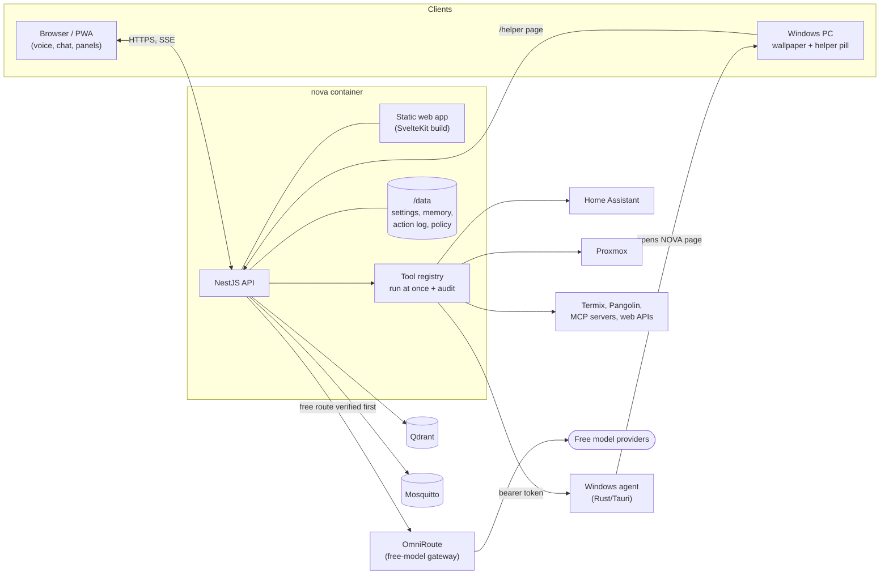

# Architecture and development

## Overview

NOVA ships as **one Docker image**: a NestJS API that also serves the built SvelteKit web app as static files, so there is no separate web server. Speech (Microsoft neural voices through `msedge-tts`) and NOVA's own tools (Proxmox, timers, lists, checks) are modules of the API and need no container of their own. The services NOVA talks to keep their own images: OmniRoute, Mosquitto, Qdrant, Node-RED and Home Assistant. Node-RED is required by the Compose stack and holds the schedules and flows ([Node-RED](integrations.md#node-red-and-mqtt)).



All runtime state lives outside the image in the data folder (`nova-data/` in production, `dev-data/` in development): settings, memory, the action log, the routing policy, MCP configuration and certificates. Nothing in the repository changes at runtime and no secret is committed. See [Configuration](configuration.md#the-data-folder).

The current event topics and MQTT/HTTP boundaries are documented in [Node-RED](integrations.md#boundaries-mqtt-and-http). MQTT remains publish-only from NOVA; Node-RED may post allow-listed notifications to NOVA over authenticated HTTP.

## Node-RED responsibilities

Node-RED owns orchestration across time and events: schedules, retries, event-to-service wiring and operator-authored flows. It may call service APIs directly for routine integrations, but it must not hold a second copy of NOVA's logic; the only gate on its callbacks is the bearer token below.

NOVA's NestJS modules remain the authority for service credentials, tool schemas, risk labels, allowlists, validation, audit and post-action verification. NOVA itself has no user login and no approval step; a flow that asks NOVA to perform an action must use a narrow bearer-token API/tool boundary (`NODE_RED_EVENT_TOKEN`, `NODE_RED_FLOW_TOKEN`), and NOVA treats it like a chat request. Flow inputs and returned data are untrusted and bounded. The current Node-RED event endpoint accepts allow-listed alerts and runtime errors only; it does not run tools or model actions. MQTT is the existing publish-only status/event bus, not a flow-trigger or command channel. See [Node-RED](integrations.md#boundaries-mqtt-and-http) for the implemented boundary.

## Repository layout

| Path                 | What                                                                                              |
| -------------------- | ------------------------------------------------------------------------------------------------- |
| `apps/api`           | NestJS backend (ESM, TypeScript strict). One folder per domain. Serves the web app in production. |
| `apps/web`           | SvelteKit app built with `adapter-static` (single-page, fallback `index.html`) and Svelte 5.      |
| `packages/contracts` | Types shared by API and web, types only.                                                          |
| `apps/windows`       | The native Rust/Tauri Windows agent. See [Windows agent](windows-agent.md).                       |
| `deploy`             | Production `docker-compose.yml` and the default `mcp-servers.json`.                               |
| `docs`               | This documentation, screenshots (`docs/img`) and release notes.                                   |
| `scripts`            | Dev runner, release script, Playwright checks and runtime tests.                                  |

Rules that keep it clean:

- A module in `apps/api` uses another module only through what that module exports (its service), never by importing its files.
- `core/` holds what every module needs (config, security, audit, state, MQTT, HTTP helpers) and knows no domain.
- Configuration is read once in `NovaConfig` (`core/config/nova-config.ts`); the rest of the code does not read `process.env` (two documented exceptions: the secret masking and `NODE_EXPORTER_URL`, plus MCP `${VAR}` references).
- Components in `apps/web` never call `fetch` themselves; all calls go through `src/lib/api/`.
- Types that cross the API boundary live in `packages/contracts` and are imported with `import type`.
- Relative imports in the API use the `.js` extension (ESM, NodeNext).

## API modules

One folder per domain under `apps/api/src/`, wired together in `app.module.ts`. All routes live under `/api` except `/nova-ca.crt`. Windows installers are distributed through GitHub Releases.

| Module                          | Does                                                                                                                                                                                                                                                                                            |
| ------------------------------- | ----------------------------------------------------------------------------------------------------------------------------------------------------------------------------------------------------------------------------------------------------------------------------------------------- |
| `core`                          | `NovaConfig`, `sanitize`, net guard and safe requests, JSON client, audit log, component state, MQTT, error shape.                                                                                                                                                                              |
| `health`                        | `GET /api/nova/health`.                                                                                                                                                                                                                                                                         |
| `tools`                         | The registry and the one way to run a tool: clean and check arguments, decide the real risk label, run it at once, write the log. Tool sources register themselves with `@ToolSourceProvider()`. `GET /api/tools`, `POST /api/actions/execute`.                                                 |
| `confirmations`                 | Legacy plumbing from the confirmation flow; nothing waits for approval any more, so it is effectively unused.                                                                                                                                                                                   |
| `chat`                          | `POST /api/chat`, `POST /api/chat-stream` (server-sent events). The orchestrator (tool loop), prompt, context builder, OmniRoute client and the spoken summary of command output.                                                                                                               |
| `memory`                        | Conversations and session context (`memory.json`); long-term memory in Qdrant or OmniRoute; `/api/memories`, `/api/memory/:session`, `/api/audit`.                                                                                                                                              |
| `routing`                       | The free-model policy check, OmniRoute's management API, `/api/providers`, `/api/gateway`. See [OmniRoute](integrations.md#language-models-omniroute).                                                                                                                                          |
| `settings`                      | Skills, persona, quick actions, tool switches, sidebar, custom panels (widgets), back-up, wallpaper and helper pickers; `/api/settings/*`, `/api/widgets/*`.                                                                                                                                    |
| `dashboard`                     | `/api/system` (host metrics), `/api/overview`, `/api/alerts`, `/api/health` (integration status), `/api/integrations`.                                                                                                                                                                          |
| `tts`                           | `POST /api/tts`: speech with Microsoft's neural voices (default `nl-NL-FennaNeural`, selectable), in Node, with a small sentence cache.                                                                                                                                                         |
| `proxmox`, `planning`, `checks` | Guests, storage and tasks; timers, lists and the daily briefing; reachability checks and the watchdog that raises alerts. They also provide `system_time`.                                                                                                                                      |
| `home`                          | Home Assistant: catalog of entities, tools, risk rules, verification of effects, `GET /api/entities`.                                                                                                                                                                                           |
| `integrations/*`                | `world` (weather, search, news, ...), `mcp` (MCP client hub), `termix` (with direct SSH fallback), `windows` (programs, wallpaper, helper), `browser-agent` (the `browser_*` tools, served by the same Windows agent), `pangolin`, `youtube` (no subtitle or OAuth features, see Known limits). |
| `agent`                         | Background tasks that run at once: `/api/agent/runs`; `planning/autonomy` holds the durable task runner. See [Autopilot](features.md#autopilot-nova-takes-initiative).                                                                                                                          |
| `objectives`                    | Standing goals checked on a schedule with read-only tools only: `/api/objectives`. See [Objectives](features.md#standing-objectives).                                                                                                                                                           |
| `apis`, `autopilot`             | The HTTP API engine for your own APIs as tools ([API engine](integrations.md#your-own-http-apis)) and the autopilot ([Autopilot](features.md#autopilot-nova-takes-initiative)).                                                                                                                 |
| `notes`                         | Explicit private notes: `/api/notes`.                                                                                                                                                                                                                                                           |
| `visualization`                 | Holographic scenes and inline cards built from real tool results: `/api/visualizations`. See [Holographic engine](#holographic-visualization).                                                                                                                                                  |
| `desktop`                       | Seeing and controlling the PC through the Windows agent, off by default: `/api/settings/desktop`. See [Windows desktop control](windows-agent.md#windows-desktop-control-and-helper).                                                                                                           |
| `telephony`, `conversation`     | Asterisk/Linphone calls and the spoken conversation engine: `/api/telephony`, `/api/settings/conversation`. See [Telephony](integrations.md#telephony-and-conversations) and [Conversations](integrations.md#telephony-and-conversations).                                                      |
| `downloads`                     | The CA certificate for devices that need it; Windows installers come from GitHub Releases.                                                                                                                                                                                                      |
| `bridges`                       | The glue where one module needs something another owns, by an agreed shape.                                                                                                                                                                                                                     |

### The bridges

`bridges/bridges.module.ts` keeps modules independent of each other. It provides:

- `LLM_CLIENT`: the settings module asks the language model for help (skill drafting and improving) without knowing OmniRoute; it is the same `OmniRouteClient` the chat uses, so the free-route check applies to it too.
- `WALLPAPER_PORT`: the settings screen sets the Windows wallpaper, mode and helper size without knowing the Windows agent.
- `HOME_ALIAS_LOOKUP`: Home Assistant resolves names the user taught NOVA ("the big lamp") through long-term memory entries of type `LEARNED_ALIAS`.
- A home source for the weather tools: "home" follows Home Assistant's `zone.home`.

## A chat request

1. The web app posts to `/api/chat-stream` and reads server-sent events (`connected`, `tools`, `token`, `tool_start`, `tool_result`, `done`, `error`).
2. The orchestrator takes the message as a new request.
3. Otherwise it verifies the free route (it throws and nothing is sent if that fails), builds the context (persona, matching instruction skills, session memory, relevant long-term memories) and calls OmniRoute with the enabled tools.
4. Tool calls the model makes (at most eight per reply, at most `NOVA_MAX_TOOL_ITERATIONS` rounds) run through `ToolsService`. Every call runs at once and is audited.
5. The answer streams to the browser, which speaks it with `/api/tts`. Every event is sanitised on the way out.

## Web app

`apps/web/src/`:

- `routes/+page.svelte`: the main view: the particle sphere, two columns of side panels, the stage with the conversation, the composer and the dialogs. `routes/helper/`: the compact helper page.
- `lib/api/`: one file per API area.
- `lib/chat/`: the chat stream (`ask`), SSE parsing, alerts.
- `lib/entity/`: the particle sphere and the helper's orb (canvas).
- `lib/voice/`: speaking, listening (the browser's speech recognition), the "Hey NOVA" wake word, mobile audio unlock.
- `lib/modes/`: wallpaper mode, device detection, PWA registration.
- `lib/stores/`: shared state (Svelte 5 runes).
- `components/shell`, `hud`, `settings`, `admin`, `helper`, `ui`: one component per part of the screen. The built-in side panels are Systeem, Virtuele machines, Opslag, Buiten, Lucht, Maan en dag, Huis, Markt, ISS (left) and Nu, Server, Stem, Planning, Nieuws, Activiteit (right); custom panels come from Settings.
- `static/`: the web manifest, service worker and icons that make it an installable PWA. The microphone and installing need a secure origin: HTTPS (or `localhost`).

The interface text is Dutch and the speech voice is Dutch; the code, tool descriptions for the model and this documentation are English.

## Tests

- `apps/api/test`: Vitest, one folder per module, run with `npm test`.
- `apps/windows`: native core/agent tests, Windows Clippy checks and installer builds in CI.
- `apps/web`: Vitest unit tests (`npm test -w @nova/web`) and manual Playwright checks, see [Development](#browser-checks).
- There is no end-to-end suite for the interface in the repository.

## Settings workspace

The settings live on their own route (`apps/web/src/routes/settings/`), with navigation and search sharing one catalogue in `apps/web/src/components/settings/sections.ts`. There are service and task pages plus one expert area; each setting lives in exactly one place, and every older section id still resolves through `LEGACY` redirects, so old deep links work.

| Page (Dutch label)     | Holds                                                                                                 |
| ---------------------- | ----------------------------------------------------------------------------------------------------- |
| Gesprek en stem        | Quick actions, voice and sound, talking with NOVA, personality and profiles, installing the app.      |
| Koppelingen            | Home Assistant, Node-RED flows, other connections, services and MCP.                                  |
| Windows-pc             | Pairing, access, viewing and control, helper and wallpaper.                                           |
| Telefoon               | Telephony, extensions and the doorbell.                                                               |
| Slimme modellen        | AI accounts, the free policy, model roles, availability.                                              |
| Wat NOVA zelf mag doen | Enabled tools, objectives.                                                                            |
| Geheugen en privacy    | What NOVA remembers, documents, backup.                                                               |
| Geavanceerd            | All tools, own skills, code projects, sidebar and panels, updates, action log, rerun setup, own APIs. |

Each page has a purpose line, a status pill, the common settings, and closed "Geavanceerd" and "Wijzigingsgeschiedenis" disclosures. Status labels describe verified checks, not merely stored configuration. The settings keep their state, secret replacement and save handlers; the page uses NOVA's navy palette and Sora type, 44 px minimum targets, visible focus and reduced motion, and mobile adds a grouped section selector. A one-time server-local snapshot `settings.json.before-settings-page-v1` was written when this layout replaced the old dialog; it is never part of a download. Browser coverage is `scripts/check-settings.mjs` (navigation, overflow, saving, secret clearing and rollback at desktop 1x/2x and mobile, with mocked endpoints and synthetic data), plus `check-settings-nav.mjs` and `check-settings-receipts.mjs`. The settings screens, the free-policy wizard and the history and rollback panels have no lock of their own; the reverse proxy in front of NOVA is the access control.

## Holographic visualization

One reusable platform component that shows data as a 3D or 2D graph, chart or 3D model. It is not tied to a single source: providers deliver a scene and the viewer draws it. Everything shown comes from real data of existing services; what is unknown stays unknown. Open items are at the end ("Honest status").

### Overview

Examples from the browser check (mocked, non-personal data):  

```
chat / voice ("show my Proxmox")
   └─ tool create_visualization ──► VisualizationService ──► provider.build()  (real data)
                                         │                       Proxmox · Home Assistant · network · AI activity
                                         ├─ SSE event "visualization" in the chat stream → the screen opens the view
                                         └─ GET /api/visualizations/:id (poll for live scenes)
web: HoloPanel ── HoloViewer ── HoloEngine (three.js, lazy) | HoloChart (SVG) | HoloTable (text version)
```

| Part                                            | Path                                                                                  |
| ----------------------------------------------- | ------------------------------------------------------------------------------------- |
| Scene types (shared)                            | `packages/contracts/src/visualization.ts`                                             |
| API: service, registry, validation, tools, REST | `apps/api/src/visualization/`                                                         |
| Providers                                       | `apps/api/src/visualization/providers/{proxmox,home,network,ai-activity}.provider.ts` |
| Viewer library                                  | `apps/web/src/lib/holo/`                                                              |
| Components                                      | `apps/web/src/components/holo/`                                                       |
| Browser check                                   | `scripts/check-holo.mjs`                                                              |

### The scene (`VizScene`)

One JSON description, three kinds (`kind`):

- `graph`: `nodes` (`id`, `label`, `kind`, `parent`, `layer`, `status`, `value` 0..1, `size`, `detail`, optionally a real `position`) and `edges`. The layout is a deterministic radial tree (`lib/holo/layout.ts`): the `parent` chain gives the rings, with no randomness, so a refresh does not shuffle the picture. Only a real `position` (imported model or your own space definition) is used; floor plans are never invented.
- `model`: `models` (GLB, GLTF, STL or 3MF via `url`), `hotspots`, and `units` for measurements.
- `chart`: `chart` (`bar` or `line`, `unit`, series with points; `null` means "unknown").

Also: `layers`, `modes` (only the modes that fit the content), `defaultMode`, `notes` (what is not shown or not known), `actions` (sentences the user can send to NOVA), `refreshMs` (live scenes) and `view` (the state the tools change: mode, 2D/3D, highlights, annotations, hidden layers, camera, rotations, selection).

`status` is one of `ok`, `active`, `warning`, `critical`, `off`, `unknown`. "Unknown" is always drawn as a dotted or wireframe outline and never as healthy. Shape (sphere, box, cylinder, octahedron, icosahedron) depends on `kind`, so status does not rely on color alone.

Validation (`scene.validation.ts`) rejects, among other things: duplicate or invalid ids, edges to unknown nodes, unknown parents and parent loops, values outside 0..1, non-finite positions, more than 1500 nodes, 4000 edges or 12 models, unsupported model formats, and model URLs that are not an own `/api/...` path or a `blob:` URL (no external hosts).

### Viewer component (stable API)

```svelte
<script lang="ts">
  import HoloViewer from "#components/holo/HoloViewer.svelte";
  let viewer: HoloViewer;
  let scene: VizScene;          // from /api/visualizations or built yourself
</script>

<HoloViewer bind:this={viewer} {scene}
  bind:mode bind:dimension bind:selected bind:measuring bind:showTable bind:theme
  quality="auto" toolbar={true}
  onselect={(id, info) => …} onhotspot={(id) => …} onmeasure={(list) => …} onload={(state) => …} />
```

| Prop                                           | Meaning                                                                                                                                                                 |
| ---------------------------------------------- | ----------------------------------------------------------------------------------------------------------------------------------------------------------------------- |
| `scene`                                        | Required, a `VizScene`. Same `id` and same drawing data: only the `view` is applied (the camera stays). Other data: rebuilt, the camera stays for the same `id`.        |
| `mode` (bindable)                              | `holographic`, `realistic`, `wireframe`, `technical`, `heatmap`, `xray`; `null` = the scene's own. A mode that does not fit the content falls back to the default mode. |
| `dimension` (bindable)                         | Graphs only: `2d` (flat, pan and zoom) or `3d`.                                                                                                                         |
| `theme` (bindable)                             | `dark` (default), `light`, `auto` (follows `prefers-color-scheme`).                                                                                                     |
| `quality`                                      | `auto` (lowers itself when frames are slow), `high`, `medium`, `low`.                                                                                                   |
| `selected` (bindable)                          | Id of a node, model part or hotspot.                                                                                                                                    |
| `measuring` (bindable)                         | Two clicks on a model give the distance in `scene.units`.                                                                                                               |
| `showTable` (bindable)                         | Shows the accessible table view instead of the picture.                                                                                                                 |
| `toolbar`                                      | `false` hides the built-in buttons (mode, 2D/3D, camera, layers, table, theme, image, fullscreen, measure).                                                             |
| `onselect`, `onhotspot`, `onmeasure`, `onload` | Callbacks. `onload` receives `{state: "loading", progress, label}`, `{state: "ready"}` or `{state: "error", message}`.                                                  |

Methods (via `bind:this`): `fit()`, `focus(id, preset?)`, `setCamera(preset)`, `rotateObject(id, axis, degrees)`, `clearMeasurements()`, `screenshot(): Promise<Blob | null>`.

Loading a model:

```ts
const scene: VizScene = {
  schema: 1,
  id: "viz-…",
  title: "Part",
  kind: "model",
  providerId: "example",
  typeId: "model",
  revision: 1,
  updatedAt: new Date().toISOString(),
  models: [
    {
      id: "m1",
      label: "Bracket",
      format: "stl",
      url: "/models/bracket.stl",
    },
  ],
  units: "mm",
  layers: [],
  notes: [],
  actions: [],
  modes: ["holographic", "realistic", "wireframe", "technical", "xray"],
  defaultMode: "holographic",
  view: { highlights: [], annotations: [], hiddenLayers: [], rotations: [] },
};
```

- `url` is a path on NOVA itself (`/api/...`, same origin, with cookie) or a `blob:` URL the page created itself (for example from a file picker). Maximum size 150 MB. GLTF must be self-contained (GLB, or glTF with embedded data); Draco and KTX2 are not decoded.
- STL and 3MF are Z-up by convention: the camera then uses Z as up, the ground grid lies in the XY plane, and hotspots and measurements use the model's own coordinates. GLB is Y-up.
- Parts inside a model (mesh names) can be selected, highlighted and switched on or off (Layers); their id is the path `modelId/.../name`, or just the name.
- Or use the tool: `load_3d_scene`.
- For your own backend, register a provider (below) or build the scene yourself and pass it to `HoloViewer` directly; both work.

#### Controls

Mouse: drag rotates (2D: pans), scroll zooms, right button pans. Touch: one finger rotates or pans, two fingers pinch and pan. Keyboard (canvas focused): arrows pan, `+`/`-` zoom, `[` and `]` (or `p` and `n`) select the previous or next object, `0` or Home fits everything, Esc clears the selection. The canvas has `role="application"`; the full content is also available as tables in the table view (`Tabel`), which is also the fallback without WebGL. Without WebGL a graph is drawn as flat SVG; a model then shows only the table and a notice.

#### Rendering and memory behavior

- Three.js (`three@0.186.1`, pinned exactly, published 2026-09-24, a devDependency like the rest of the web app; `@types/three@0.186.0`) is loaded only when a viewer appears (dynamic import, own chunk). The loaders (GLTF, STL, 3MF) and the bloom passes load only when needed. `three/examples` includes `fflate` for 3MF, so no extra dependency.
- There is no idle render loop: a frame is drawn only after a change (camera, mode, selection, size) plus a short intro (1.5 s) that stops by itself. Camera damping stops once it is still. `canvas[data-frames]` counts drawn frames; the browser check guards that it does not grow at rest.
- `prefers-reduced-motion`: no camera flights, no damping, no intro animation.
- Quality `auto` lowers (high, medium, low: pixel ratio and bloom) when consecutive frames average slower than 34 ms, never at rest. Bloom is deliberately restrained and only in holographic mode on the dark theme.
- Cleanup: removing the viewer releases all geometries, materials, textures, the composer and the renderer, calls `forceContextLoss()` and removes the canvas. The browser check verifies the WebGL context is really released. Context loss by the browser shows an error with the table view as the way out.
- WebGPU: not built (the gain is small, support differs, and the WebGL route is the same everywhere). Possibly later behind the same `HoloEngine`.

#### Modes

Only modes that fit the content are offered: a graph has holographic, realistic, wireframe and (only when nodes have a `value`) heatmap; a model has holographic, realistic, wireframe, technical, x-ray and heatmap when values exist; a chart has only its own SVG view. The server (`modesFor`) and the viewer (`availableModes`) apply the same rules. Holographic: cyan, half transparent (fresnel edge), contours, fixed scan lines and limited bloom.

### Providers

Interface: `apps/api/src/visualization/visualization.types.ts`.

```ts
class MyProvider implements VisualizationProvider, OnModuleInit {
  readonly id = "my-source";                       // [a-z][a-z0-9-]
  readonly label = "My source";
  readonly types = [{ id: "overview", title: "…", kind: "graph", description: "…", keywords: ["…"] }];
  readonly requires = { service: "my-service", access: "read-only" };   // security requirement
  constructor(private readonly registry: VisualizationRegistry, …) {}
  onModuleInit() { this.registry.register(this); }
  available() { return { ok: true } /* or { ok: false, reason: "Not connected." } */; }
  async build(typeId, { signal, params }): Promise<ProviderScene> { /* real data → nodes/edges/models/chart */ }
  describe?(typeId, objectId, ctx)                  // extra facts for show_object_details
}
```

- Providers are read-only: they read an existing service and use the same access rules (for example `ProxmoxService` already filters on allowed nodes and guests, `HomeAssistantService.visibleEntities()` on allowed devices).
- Actions: `actions` are sentences ("Start VM 105") the user can send to NOVA. They go through the normal tools, which run at once. The viewer itself never executes anything.
- Subscriptions: a scene with `refreshMs` (5 s to 5 min) is polled by the viewer (`GET /api/visualizations/:id?since=<revision>`, only while the tab is visible). The server rebuilds the scene, shares one rebuild between concurrent polls, keeps the last good scene on an error and raises the revision only on real change. Tool changes (highlight, camera, ...) arrive through the existing SSE event `visualization` in the chat stream. There is no separate SSE stream per scene; polling is deliberately enough for these speeds.
- Another module imports `VisualizationModule`, injects `VisualizationRegistry` and registers its provider, or creates scenes through `VisualizationService.createCustom({ kind: "model", models, … })`.

Bundled providers (all read-only):

| Provider         | Source                                                                                                               | Types                                          | Honesty                                                                                                                                                                                              |
| ---------------- | -------------------------------------------------------------------------------------------------------------------- | ---------------------------------------------- | ---------------------------------------------------------------------------------------------------------------------------------------------------------------------------------------------------- |
| `proxmox`        | `ProxmoxService` (nodes, guests, storage)                                                                            | `topology` (graph), `load` (bar chart CPU/RAM) | Status follows Proxmox status; stopped guests have no CPU value; unknown state stays unknown; storage without a node hangs under the cluster.                                                        |
| `home-assistant` | `HomeAssistantService.visibleEntities()`                                                                             | `home`                                         | Rooms are Home Assistant's rooms, drawn as groups. No floor plan (that needs an imported model or your own room definitions). People and trackers are not shown here. At most 350 devices.           |
| `network`        | `ChecksService` (reachability and response time), `HostMetricsService.network`, `device_tracker` from Home Assistant | `overview` (graph), `latency` (chart)          | Real measurements only. No router, switch or AP telemetry, so those are not drawn. Throughput is "unknown" without node-exporter. Heat color is response time (1000 ms = full), stated in the scene. |
| `ai-activity`    | action log (`AuditService`)                                                                                          | `graph`, `calls`                               | Real tool calls only (which, when, success, risk, duration). Arguments and results are not read. It never shows model reasoning, and the scene says so.                                              |

### Tools

Source `visualization` (`visualization.source.ts`). All ten are `READ_ONLY`: they change only what NOVA's screen shows and read existing services; they control nothing outside NOVA. Device control stays with the existing tools. Results contain counts and ids, not the whole scene (which is also in the audit log).

| Tool                   | Does                                                                                                                                                                                        |
| ---------------------- | ------------------------------------------------------------------------------------------------------------------------------------------------------------------------------------------- |
| `create_visualization` | Opens a view for `proxmox`, `network`, `home-assistant`, `ai-activity` (or `provider:type`, or a short description such as "my network") or a custom graph or chart with `source: "custom"` |
| `update_visualization` | Title, mode, 2D/3D, refresh, or replace the data of a custom scene                                                                                                                          |
| `load_3d_scene`        | Shows models (glb/gltf/stl/3mf, own `/api/...` path or `blob:`) and hotspots                                                                                                                |
| `highlight_object`     | Highlights objects (or clears with `replace` and an empty list)                                                                                                                             |
| `rotate_object`        | Rotates an object or the whole scene around x/y/z to absolute degrees                                                                                                                       |
| `focus_camera`         | Camera to an object and/or preset (`iso`, `front`, `back`, `left`, `right`, `top`, `bottom`)                                                                                                |
| `show_object_details`  | Selects an object and returns its facts (status, values, connections)                                                                                                                       |
| `annotate_object`      | Short text on an object                                                                                                                                                                     |
| `clear_visualization`  | Closes and forgets a scene (`all` for all)                                                                                                                                                  |
| `export_visualization` | JSON or CSV as text (at most 20,000 characters; the viewer has the full download)                                                                                                           |

Chat and voice: the system prompt asks for `create_visualization` only when the user wants to _see_ something ("show my Proxmox", "show the network", "visualize my house") and a text answer for ordinary questions ("how many VMs are running", "what is the status"). `isDisplayRequest()` (`intent.ts`) pins this distinction in tests and `resolveTopic()` maps the description to a provider. The chat SSE event `visualization` (`{id, title, kind, revision, action}`) makes the screen open the view; without an open screen nothing happens (a scheduled task never opens anything). Manually: menu, "Visualisaties".

### Cards in the conversation (inline holograms)

When NOVA answers with real tool data that a picture helps, a compact holographic card appears directly under the answer on screen (no separate panel), with "Uitvergroten" (opens the same card in the panel), "Tabel" (text version of all data) and "3D"/"Vlak".

**The decision is made in the backend, deterministically** (`apps/api/src/visualization/auto-card.ts`, hook in `orchestrator.service.ts`): only from the tool name and the RESULT that actually arrived; never from model text and never invented. No card for a failed tool, an empty result, an invalid scene or more than 24 KB; one card per turn (the first); no card if the model itself used `create_visualization`. The scene travels in the existing SSE event `visualization` with `action: "inline"` and `scene`; it is not kept on the server and the panel does not open by itself. Secrets: only display names, state words and numbers; no attributes, tokens, locations, people or trackers (only for `home_status` as "Wie is thuis"), host names or error details.

| Tool                              | Card                                                                                                                                                                   |
| --------------------------------- | ---------------------------------------------------------------------------------------------------------------------------------------------------------------------- |
| `weather_forecast`                | `weather`: now block, hourly temperature curve, rain-probability bars, a glyph per hour (night variants via sunrise and sunset), day strip with min/max and rain in mm |
| `proxmox_status`, `proxmox_nodes` | `gauges`: CPU and memory per node (75% attention, 90% problem); an offline node is "unknown"                                                                           |
| `proxmox_storage`                 | `gauges`: used space (80% / 90%)                                                                                                                                       |
| `proxmox_guest_status`            | `gauges`: CPU and memory of one running guest                                                                                                                          |
| `proxmox_guests`                  | `tiles`: rack per node, state in words (Draait/Gestopt/Gepauzeerd/Onbekend), at least 2 guests                                                                         |
| `network_check`                   | `tiles`: service reachable / not reachable with response time                                                                                                          |
| `home_status`                     | `tiles`: who is home, lights, switches, climate, temperatures, music                                                                                                   |
| `ha_search_entities`              | `tiles` per room (without person, device_tracker, camera, alarm); battery and power sensors get a status                                                               |
| `ha_get_state`                    | `gauges`, only for a % sensor                                                                                                                                          |
| `calendar_events`                 | `timeline`: today (or the next day with appointments) with a "now" marker                                                                                              |
| `timer_list`                      | `timeline`: countdown bars until they fire                                                                                                                             |
| `list_show`                       | `tiles`: one tile per list, at least 2 lists                                                                                                                           |

There is no energy or host-metrics tool (yet); power usage appears as a tile or gauge when Home Assistant sensors (`device_class` power, energy or battery) come through `ha_search_entities`. The scene type `series` (3D bar or area chart with axes, unit and tooltips) is ready for time series (energy, temperature history) as soon as a source supplies them; it is not filled automatically yet.

#### New scene kinds (`VizSceneKind`)

`weather`, `gauges`, `timeline`, `tiles`, `series` (next to `graph`, `model`, `chart`). Fields: `weather`, `gauges`, `timeline`, `tiles` + `tileGroups`, `chart` (with `type: "area"` for `series`) and `summary` (one sentence: the text replacement). Validation is in `card.validation.ts` (limits: 48 hours, 10 days, 16 gauges, 40 timeline items, 120 tiles, 200 series points; an unknown gauge value must never read as "fine"). Providers `proxmox:rack` (tiles per node with storage) and `network:status` (tiles) give structure instead of floating spheres; `topology` and `overview` stay for the graph.

#### Rendering

`lib/holo/card/*` computes one layout in pixels (shapes, lines, labels, glyphs; `layoutCard(scene, width)`, pure and tested); `HoloCard.svelte` always draws it as flat SVG (fully readable, sharp text) and, when the card is visible, through the lazy `card3d.ts` (three.js, own chunk) as a shallow hologram: transparent planes with glowing edges, a short power-on animation, dragging tilts, double-click resets. Labels stay HTML/SVG and are projected onto the picture. No idle loop: frames only on change and during the intro, and only while visible (IntersectionObserver). Cleanup releases geometries, materials, renderer and WebGL context; at most 2 simultaneous 3D cards, the rest (and the history list) stay flat. It falls back to flat for `prefers-reduced-motion`, a power-saving device (`saveData`, at most 2 GB memory, at most 2 cores, battery under 20% without charger) or no WebGL; the user can switch 3D on with one click. The height is fixed before loading (no jumping). `HoloScene.svelte` chooses between card and `HoloViewer` in the panel.

Browser check: `NOVA_HOLO_ONLY=card node scripts/check-holo.mjs` (fixtures in `scripts/holo-card-fixtures.mjs`; screenshots with `NOVA_HOLO_SHOTS`).

### Security and privacy

- All routes (`/api/visualizations/...`) sit behind the normal app access.
- Model files: own origin (`/api/...`) or `blob:` only; the server (`isSafeModelUrl`) and the viewer (`assertSafeUrl`) refuse external hosts, `..`, backslashes and control characters. Files are at most 150 MB; a corrupt file gives an error message, not a crash.
- Provider errors reach the model or the user only as fixed text; host names and error details do not leak.
- Scenes live in memory only (at most 30, 6 hours unused), not on disk.
- CSV export prefixes a `'` to cells that begin with `=`, `+`, `-` or `@`.
- The AI-activity provider reads only tool name, session (as "Gesprek n"), outcome, risk, duration and time.

### Tests and checks

- API: `npm -w apps/api test -- test/visualization` (scene validation, provider mapping with real-shape fixtures, tool contract through the real `ToolsService`, intent).
- Web: `npm -w apps/web test -- src/lib/holo` (layout, modes, table, colors, measuring).
- Browser: `node scripts/check-holo.mjs` (default `https://localhost:5173`, or `NOVA_HOLO_TEST_URL`; `NOVA_HOLO_SHOTS=<dir>` keeps screenshots; `NOVA_HOLO_ONLY=<part of name>` runs one check). It uses the real shell with a mocked API and Chromium with software WebGL, and checks drawing in all modes, STL/GLB/3MF (self-built cube), measuring, selection, layers, table, theme, no frames at rest, release of the WebGL context, error paths, no WebGL, reduced motion and mobile width.

### Honest status

Built and tested locally; not deployed and not tried against a real Proxmox, Home Assistant or network in a real conversation. Open: a real model choosing `create_visualization` by voice (model choice stays model-dependent), WebGPU, Draco and KTX2, a full SSE stream per scene, and a floor-plan editor for Home Assistant. See also [Known limits](#known-limits).

## Known limits

- The native Windows app has core and transport tests, Windows compilation and lint checks and GitHub installer builds. Capture, input, browser automation, UAC, tray, hotkeys and wallpaper placement still need acceptance testing on real Windows.
- Voice quality, hands-free barge-in thresholds and phone calls (Asterisk with Linphone) are not verified with real microphones, speakers or SIP providers.
- No real model has been proven to choose the visualization tools unprompted; the holographic cards and viewer are tested with fake data.
- The memory lifecycle exists only for the Qdrant backend and was tested against a fake Qdrant.
- Data backups cover NOVA's own data folder only, see [Getting started](getting-started.md#backups).
- Rolling back free-policy changes is disabled because OmniRoute's key-permission endpoint has no compare-and-swap.
- Linphone end-to-end encrypted (LIME) chat is not supported by the Asterisk route; `deploy/linphone-chat` is an untested spike, see [Linphone encrypted chat](integrations.md#encrypted-linphone-chat-bridge).
- Free providers: Cloudflare, Gemini and Mistral were verified first; Groq, Cohere and HuggingFace were added through the free-policy wizard; SambaNova answered `402 insufficient balance` and is not part of the policy. A deactivated or invalid account makes the wizard reject a replacement and can leave chat blocked (remove it from the selection and confirm again). Daily quotas (Cloudflare 429, Groq's small limits) make single requests fail now and then; the model roles list several providers so the next one is tried.
- Removed on purpose: 3D printing (fabrication, CAD worker, slicer, agent endpoints) and YouTube subtitles with their OAuth. Do not rebuild them without a new request.

## Development

### Requirements

- Node 24 or newer (`.nvmrc` says `24`; `engines` in `package.json` is `>=24`) and npm 10.
- Docker, for the services NOVA talks to (OmniRoute, MQTT, Qdrant).
- Optional: a Rust toolchain to work on the Windows app in `apps/windows` (see [Windows agent](windows-agent.md#development)).

### Set up

```sh
cp .env.example .env                              # fill in the keys you have
docker compose -f docker-compose.dev.yml up -d    # OmniRoute, MQTT, Qdrant, Node-RED
npm install
set -a; . ./.env; set +a                          # NOVA does not read .env itself: export it
npm run dev                                       # API on :3000, web on :5173 (proxies /api)
```

NOVA reads only real environment variables; it does not load a `.env` file. In production Docker Compose passes `.env` in. In development, export the file into your shell as above (or set the variables you need inline) before `npm run dev`.

The development compose file (`docker-compose.dev.yml`) starts OmniRoute (port 20128, data in `dev-data/omniroute`), Mosquitto without authentication (1883), Qdrant (6333, data in `dev-data/qdrant`) and Node-RED (1880, editor bound to localhost). Prepare its persistent folder for the image's uid 1000 before first start: `mkdir -p dev-data/node-red && sudo chown -R 1000:1000 dev-data/node-red`. Home Assistant is not included; point `HOME_ASSISTANT_URL` at yours.

NOVA itself runs on the host with `npm run dev`. That command waits for Node-RED at `NODE_RED_URL` or `http://127.0.0.1:1880` before starting the API and web app. Outside Docker the API still defaults to the compose service names (`http://omniroute:20128/v1`, `mqtt://mqtt:1883`, `http://qdrant:6333`), which do not resolve on the host, so set `OMNIROUTE_URL`, `MQTT_URL`, `QDRANT_URL` and `OMNIROUTE_DATABASE` to the published ports (for example `http://localhost:20128/v1`, `mqtt://localhost:1883`, `http://localhost:6333` and `./dev-data/omniroute/storage.sqlite`). Without them the corresponding features report themselves unavailable.

For Node-RED callbacks, set `NODE_RED_EVENT_TOKEN` to the same generated value in the shell used for Compose and NOVA. See [Node-RED](integrations.md#boundaries-mqtt-and-http).

### Ports and runtime data

| What               | Port | Notes                                                                             |
| ------------------ | ---- | --------------------------------------------------------------------------------- |
| API (NestJS watch) | 3000 | `PORT` default outside the image.                                                 |
| Web (Vite)         | 5173 | Fixed (`strictPort`), reachable from the LAN, proxies `/api` to `localhost:3000`. |

All runtime data goes to `dev-data/` (ignored by git). If `dev-data/certs/cert.pem` and `key.pem` exist (or `NOVA_DEV_CERT_DIR` points at such a folder) the Vite server uses HTTPS, which the microphone needs on another machine. Create a self-signed pair with `openssl` as shown in [Getting started](getting-started.md#7-https-the-microphone-and-installing-as-an-app).

`npm run dev:background` starts everything detached with a log in `dev-data/dev.log` and prints the URL; `npm run dev:stop` stops it.

### Commands

| Command                  | Does                                                            |
| ------------------------ | --------------------------------------------------------------- |
| `npm run dev`            | API (watch) and web (Vite) side by side                         |
| `npm test`               | API tests (Vitest); web tests: `npm test -w @nova/web`          |
| `npm run lint`           | ESLint over the repository (flat config, TypeScript and Svelte) |
| `npm run typecheck`      | `tsc` for contracts and API, `svelte-check` for the web app     |
| `npm run format`         | Prettier, writing                                               |
| `npm run format:check`   | Prettier, checking (what CI runs)                               |
| `npm run build`          | Web (`apps/web/build`), then API (`apps/api/dist`)              |
| `npm start`              | Run the built API (it serves `apps/web/build` when present)     |
| `docker build -t nova .` | The production image                                            |

CI (`.github/workflows/ci.yml`) runs `format:check`, `lint`, `typecheck`, the API and web tests, `build`, the model-evaluation, Node-RED, briefing, notification, OmniRoute stream-repair, MCP sandbox and screenshot-privacy checks, and builds the image without pushing it, on every push to `main` and every pull request. Run the same before you push. Docker-based runtime checks are the opt-in `test:*:runtime` scripts in `package.json`.

### Tests

- API tests live in `apps/api/test/<module>/` and run with `npm test`, or `cd apps/api && npx vitest run test/<module>` for one module. They use fakes for Home Assistant, MCP servers and the Windows agent; no external service is needed.
- Native Windows config, authentication and HTTP tests and the app build run in the `windows` CI job; they do not prove interactive Windows behavior.
- Web unit tests run with `npm test -w @nova/web`. The Playwright browser checks in `scripts/check-*.mjs` use mocked APIs against a running dev server and are run by hand; there is no end-to-end suite in CI.

### Adding a tool

A tool source is a class implementing `ToolSource` (`apps/api/src/tools/tool.types.ts`), marked with `@ToolSourceProvider()` and registered as a provider in its module. The registry finds it by itself.

- `source`: a short id shown in settings.
- `definitions()`: name, an English description for the model, JSON-schema `parameters` (helpers `schema`, `text`, `integer`, `number`), `risk` (`READ_ONLY`, `SAFE`, `CONFIRM`, `DANGEROUS`; a label for the audit log and for read-only background use), optional `timeoutMs` and `enabled: false` when not configured.
- `prepare()` (optional): decide the real risk or adjust arguments for this call.
- `execute()`: do it and return `{ ok, result?, error?, verified? }`. Do not throw for expected failures.

Sources never ask for confirmation: `ToolsService` runs every call at once. Use `sanitize()` on anything that could hold secrets, `core/security` for outbound requests to addresses the model chose, and add a field to `NovaConfig` instead of reading `process.env`. See `apps/api/test/tools/tools.service.test.ts` for a complete example, and [Tools and safety](tools-and-safety.md).

### Editor setup

Open the repository root in VS Code, run `npm install` and install the workspace recommendations (Extensions, `@recommended`; see `.vscode/extensions.json`): Svelte, ESLint, Prettier, EditorConfig, PowerShell, Container Tools, YAML, a docstring helper and Claude Code. The workspace settings format on save, apply ESLint fixes on explicit saves, use the Svelte extension to format Svelte files and Prettier for the rest, and exclude generated output and `dev-data` from search and file watching. Accept VS Code's prompt to use the workspace TypeScript version.

**Terminal, Run Task** offers dev, build, test, lint, typecheck and format-check tasks, which reuse the npm scripts; **Ctrl+Shift+B** runs the build task.

### Code style

Prettier (`.prettierrc`) and EditorConfig define formatting. `*.ps1` files (only `.github/scripts/build-windows.ps1` remains) use CRLF line endings, see `.editorconfig`.

### New tool checklist

Fill this in for every new tool source or tool. A missing item means the tool is not enabled.

- [ ] **Purpose and owner:** one sentence on what it does, who maintains it, and which data it reads or changes.
- [ ] **Input and output:** JSON schema, limits, timeout and maximum result size. Reject invalid or surplus input.
- [ ] **Risk label:** pick `READ_ONLY`, `SAFE`, `CONFIRM` or `DANGEROUS` from the real consequences, and let the source raise it per call where target or arguments require it. It does not gate execution, but `READ_ONLY` decides whether background checks may use the tool.
- [ ] **Audit:** test that every call is logged, and that a non-read-only call writes its `execution_started` line before it runs.
- [ ] **Availability:** check behavior with a missing or offline integration.
- [ ] **Audit:** a changing action is logged before execution, a log failure blocks execution, and completion, refusal and error are recorded.
- [ ] **Secrets and personal data:** test redaction in success, error, audit, browser and model output. No credentials in logs or fixtures.
- [ ] **Network boundary:** use the matching net guard and check DNS and rebinding, redirects, private and loopback addresses, ports, timeout and response limit. For fixed APIs pin HTTPS hosts, refuse redirects unless every hop is re-checked, and bound the body before parsing. Internal service URLs must not be reachable through a general proxy.
- [ ] **Verification:** read the changed state back where possible; report `verified: null` when the outcome cannot be checked independently.
- [ ] **Regression tests:** schema and risk decision, consent, audit and privacy, network boundary, and at least one refusal and one error path.
- [ ] **Documentation:** update [Tools and safety](tools-and-safety.md) and the relevant page, and note the external contract version and remaining limits.

Record the review (tool and source, reviewer and date, risk and reasoning, data and external services, tests, open limitations) in the pull request. The checklist was validated against `ToolsService`, `net-guard.ts` and `safe-request.ts`; fixed JSON APIs refuse redirects and read at most 1.5 MB before JSON parsing. It does not replace the filled-in review or the per-tool tests.

### Model and persona evaluation

Two fixed evaluation sets keep model and prompt changes comparable: 30 persona conversation cases and ten code tasks, documented in [Model and persona evaluation](evaluation.md). Their offline tests are `npm run test:model-evaluation` (part of CI); the runners are `scripts/evaluate-persona.mjs`, `scripts/evaluate-persona-models.mjs` and `scripts/evaluate-code-models.mjs`. Run reports are not tracked: `evaluate-persona.mjs` writes to `dev-data/evaluation-runs/persona/` and the model comparisons write to the `--output` path you give. The scripts and tests parse the case tables in `docs/evaluation.md`, so keep their structure intact.

### Browser checks

Playwright checks in `scripts/check-*.mjs` run against a dev server with mocked APIs. They are manual and write the screenshots in `docs/img`: `check-helper.mjs`, `check-helper-layout.mjs`, `check-settings.mjs`, `check-settings-nav.mjs`, `check-settings-receipts.mjs`, `check-holo.mjs` (`npm run check:holo`), `check-code-workspace.mjs`, `check-conversation-feedback.mjs` and `check-live-desktop.mjs`. Install Chromium once with `npx playwright-core install chromium`. `npm run check:privacy-screenshots` (OCR, needs `tesseract-ocr`) verifies that no screenshot in `docs/img` shows private data; screenshots must use mocked data.

## Releasing

A release is a git tag, and there are two independent release streams with their own version number:

| Stream    | Version file           | Tag              | Contains                                     | Workflow jobs                        |
| --------- | ---------------------- | ---------------- | -------------------------------------------- | ------------------------------------ |
| `nova`    | `VERSION`              | `vX.Y.Z`         | web, API, Docker image, compose assets       | `image`, `omniroute-image`, `agents` |
| `windows` | `apps/windows/VERSION` | `windows-vX.Y.Z` | the Windows agent (signed installer and zip) | `windows`                            |

`.github/workflows/release.yml` runs on both tag patterns and each job selects its stream. `scripts/release.sh [nova|windows|both] [X.Y.Z|next] ["message"]` does the bump: it computes `next` from the stream's own tags (PATCH rolls into MINOR at 99, so `0.1.99` becomes `0.2.0`; versions are unpadded semver because Cargo, npm and MSI reject `0.3.00`), writes the stream's `VERSION` and syncs it (`scripts/version.mjs`) into the `package.json` files and `package-lock.json` (nova) or `Cargo.toml`, `Cargo.lock` and `tauri.conf.json` (windows) before the sanity build, commits the bump, rebases, pushes `main`, creates an annotated tag and pushes it. `scripts/release.sh --dry` only prints the plan. The image build receives the version as `NOVA_VERSION`; the Settings > Advanced > Updates section and `GET /api/nova/health` show it, and the Windows app shows its own version in its setup window and in `/v1/status` (`appVersion`). `node scripts/version.mjs check` (also run by `npm run test:version`) fails when a manifest differs from its `VERSION` file.

**Cut a release.**

1. Make sure `main` is green. CI (`.github/workflows/ci.yml`) runs format check, lint, typecheck, API and web tests, build, the model-evaluation, Node-RED, briefing, notification, OmniRoute stream-repair and MCP sandbox checks, the screenshot privacy OCR check, and a trial image build.
2. Write the short update instructions in `docs/release-notes/<tag>.md` (`vX.Y.Z.md` or `windows-vX.Y.Z.md`). The script refuses to push without that file and the GitHub release uses it as its description.
3. After explicit approval, from a clean `main`:

   ```sh
   scripts/release.sh --dry [nova|windows|both]
   scripts/release.sh --confirm <tag> [--confirm <tag>] [nova|windows|both]
   ```

   Use the tag(s) `--dry` printed; `both` needs one `--confirm` per tag. Never reuse or move a published tag, and never tag or push without approval.

4. Watch the **Release** workflow.

**What the workflow publishes.**

| Job               | Result                                                                                                                                                                                                                                  |
| ----------------- | --------------------------------------------------------------------------------------------------------------------------------------------------------------------------------------------------------------------------------------- |
| `image`           | Multi-architecture (`linux/amd64`, `linux/arm64`) image `ghcr.io/<owner>/nova` tagged `X.Y.Z`, `X.Y` and `latest`; the build argument `NOVA_VERSION` is the tag name.                                                                   |
| `omniroute-image` | `ghcr.io/<owner>/nova:omniroute-X.Y.Z` for both architectures: the audited upstream OmniRoute image plus a guarded numeric-stream compatibility patch; it does not migrate gateway data.                                                |
| `windows`         | (`windows-vX.Y.Z` tag only) `NOVA-Setup-<version>.exe`, its `.sig`, `latest.json` (on `windows-latest`) and `nova-windows.zip` (one `nova.exe`). Independent: if it fails the server images still publish but no Windows update exists. |
| `agents`          | The GitHub release with the version notes plus `docker-compose.yml` and `nova-compose.tar.gz` (compose file with `nodered`, `piper`, `asterisk` and `linphone-chat` sources).                                                           |

The image name uses the repository owner. The first time, set the package visibility to public in GitHub Packages if people should pull without logging in. The standalone **Windows application** workflow (`windows-build.yml`) produces development installers without publishing a release.

### Windows updates and signing

The Windows job needs the repository secrets `TAURI_SIGNING_PRIVATE_KEY` (the contents of the private key file) and optionally `TAURI_SIGNING_PRIVATE_KEY_PASSWORD`. `scripts/windows-update-manifest.mjs` generates `latest.json` for the exact versioned installer, and the signature binds the package version. The app reads `latest.json` from the fixed `windows-latest` update-feed prerelease (replaced on every Windows release; the `windows-vX.Y.Z` releases are never marked latest, so GitHub's `releases/latest` stays NOVA's) and requires a click to install. Details of the key, the embedded public key and the update flow are in [Windows agent](windows-agent.md#one-time-signing-setup). Confirm the Windows artifacts exist before announcing a Windows update.

### Storage notes

NOVA keeps audit entries, bounded revision histories and migrated runtime state in owner-only `nova.db` through `node:sqlite`. The database uses WAL, numbered transactional schema migrations and a single shared connection per data directory. Legacy JSON and JSONL sources import once and become `.migrated`; malformed input is preserved as `.corrupt`. Settings, service credentials and the encrypted vault that have not migrated remain JSON.

- Back up the entire data directory before upgrading. Backups snapshot SQLite with `VACUUM INTO`; never copy live `nova.db-wal` or `nova.db-shm` files. A restore validates database integrity and removes stale SQLite companions before reopening.
- Rollback to a pre-SQLite release needs the pre-upgrade data backup. Retained `.migrated` files represent import time and do not include later writes.
- Small manifests and configuration remain JSON/YAML. OmniRoute owns its separate database. GraphQL is a query language and does not replace a storage engine.
- Restored data retains owner-only permissions and secret redaction. Manifests, lockfiles and Tauri config remain intentional project files. Evaluation reports stay outside the repository. Keep `.before-*`, `.bak` and migration sources until their rollback purpose has ended.

A read-only inventory of a data folder is available with `node scripts/audit-data-storage.mjs /path/to/nova-data`. It lists only top-level regular files in recognized categories (names and sizes, by filename heuristics, never contents) and deletes nothing.
