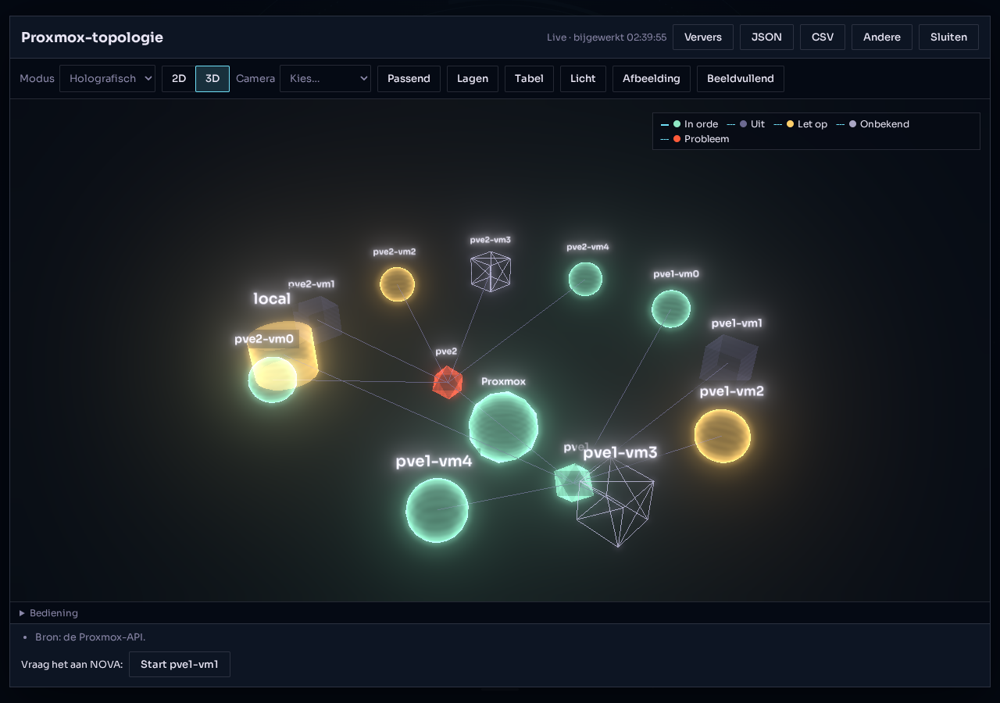
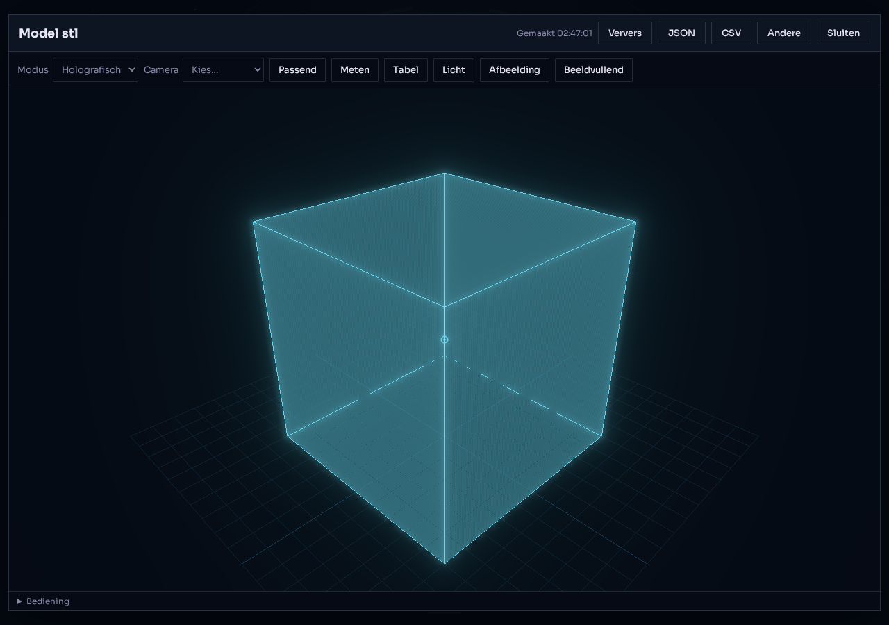

# Holografische visualisatie (Universal Holographic Viewer)

Eén herbruikbaar platformonderdeel om gegevens als 3D-/2D-graaf, grafiek of 3D-model te tonen. Het is niet gekoppeld aan 3D-printen of aan Proxmox: aanbieders (providers) leveren een scène, de viewer tekent hem. Alles wat getoond wordt komt uit echte gegevens van bestaande diensten; wat onbekend is blijft onbekend.

Status en open punten staan onderaan ("Eerlijke stand"). Taakblok: `tasks-09-10-2026.md`, fase O.

## Overzicht

Voorbeelden uit de browsercheck (gemockte, niet-persoonlijke gegevens):  

```
chat / spraak ("toon mijn Proxmox")
   └─ tool create_visualization ──► VisualizationService ──► provider.build()  (echte data)
                                         │                       Proxmox · Home Assistant · netwerk · AI-activiteit · (later: 3D-printen)
                                         ├─ SSE-event "visualization" in de chatstroom → scherm opent de weergave
                                         └─ GET /api/visualizations/:id (poll voor live scènes)
web: HoloPanel ── HoloViewer ── HoloEngine (three.js, lazy) | HoloChart (SVG) | HoloTable (tekstversie)
```

| Onderdeel                                      | Pad                                                                                   |
| ---------------------------------------------- | ------------------------------------------------------------------------------------- |
| Scènetypen (gedeeld)                           | `packages/contracts/src/visualization.ts`                                             |
| API: service, register, validatie, tools, REST | `apps/api/src/visualization/`                                                         |
| Providers                                      | `apps/api/src/visualization/providers/{proxmox,home,network,ai-activity}.provider.ts` |
| Viewer-bibliotheek                             | `apps/web/src/lib/holo/`                                                              |
| Componenten                                    | `apps/web/src/components/holo/`                                                       |
| Browsercheck                                   | `scripts/check-holo.mjs`                                                              |

## De scène (`VizScene`)

Eén JSON-beschrijving, drie soorten (`kind`):

- `graph`: `nodes` (`id`, `label`, `kind`, `parent`, `layer`, `status`, `value` 0..1, `size`, `detail`, optioneel een echte `position`) en `edges`. De indeling is een deterministische radiale boom (`lib/holo/layout.ts`): de `parent`-keten geeft de ringen, geen willekeur, dus een verversing schudt het beeld niet door elkaar. Alleen een echte `position` (geïmporteerd model of eigen ruimtedefinitie) wordt gebruikt; er worden nooit plattegronden verzonnen.
- `model`: `models` (GLB, GLTF, STL of 3MF via `url`), `hotspots`, `units` voor metingen.
- `chart`: `chart` (`bar` of `line`, `unit`, reeksen met punten; `null` is "onbekend").

Verder: `layers`, `modes` (alleen de modi die bij de inhoud passen), `defaultMode`, `notes` (wat niet getoond of niet bekend is), `actions` (zinnen die de gebruiker aan NOVA kan sturen), `refreshMs` (live scènes) en `view` (de toestand die de tools wijzigen: modus, 2D/3D, markeringen, annotaties, verborgen lagen, camera, rotaties, selectie).

`status`: `ok`, `active`, `warning`, `critical`, `off`, `unknown`. "Onbekend" wordt altijd als gestippelde of draadvormige omtrek getekend en nooit als gezond. Vorm (bol, doos, cilinder, octaëder, icosaëder) hangt af van `kind`, zodat status niet alleen aan kleur hangt.

Validatie (`scene.validation.ts`) weigert onder meer: dubbele of ongeldige ids, verbindingen naar onbekende nodes, onbekende ouders en ouderlussen, waarden buiten 0..1, niet-eindige posities, meer dan 1500 nodes/4000 verbindingen/12 modellen, niet-ondersteunde modelformaten en modelwebadressen die geen eigen `/api/…`-pad of `blob:` zijn (geen externe hosts).

## Viewer-component (stabiele API)

```svelte
<script lang="ts">
  import HoloViewer from "#components/holo/HoloViewer.svelte";
  let viewer: HoloViewer;
  let scene: VizScene;          // van /api/visualizations of zelf gebouwd
</script>

<HoloViewer bind:this={viewer} {scene}
  bind:mode bind:dimension bind:selected bind:measuring bind:showTable bind:theme
  quality="auto" toolbar={true}
  onselect={(id, info) => …} onhotspot={(id) => …} onmeasure={(list) => …} onload={(state) => …} />
```

Props:

| Prop                                           | Betekenis                                                                                                                                                                           |
| ---------------------------------------------- | ----------------------------------------------------------------------------------------------------------------------------------------------------------------------------------- |
| `scene`                                        | verplicht, `VizScene`. Zelfde `id` en dezelfde tekengegevens: alleen de `view` wordt toegepast (camera blijft). Andere gegevens: opnieuw opbouwen, camera blijft bij dezelfde `id`. |
| `mode` (bindable)                              | `holographic`, `realistic`, `wireframe`, `technical`, `heatmap`, `xray`; `null` = die van de scène. Een modus die niet bij de inhoud past valt terug op de standaardmodus.          |
| `dimension` (bindable)                         | alleen graven: `2d` (plat, verschuiven/zoomen) of `3d`.                                                                                                                             |
| `theme` (bindable)                             | `dark` (standaard), `light`, `auto` (volgt `prefers-color-scheme`).                                                                                                                 |
| `quality`                                      | `auto` (zakt zelf als frames traag zijn), `high`, `medium`, `low`.                                                                                                                  |
| `selected` (bindable)                          | id van knoop, modelonderdeel of hotspot.                                                                                                                                            |
| `measuring` (bindable)                         | twee klikken op een model geven de afstand in `scene.units`.                                                                                                                        |
| `showTable` (bindable)                         | toont de toegankelijke tabelweergave in plaats van het beeld.                                                                                                                       |
| `toolbar`                                      | `false` verbergt de ingebouwde knoppen (modus, 2D/3D, camera, lagen, tabel, thema, afbeelding, beeldvullend, meten).                                                                |
| `onselect`, `onhotspot`, `onmeasure`, `onload` | terugmeldingen. `onload` krijgt `{state: "loading", progress, label}`, `{state: "ready"}` of `{state: "error", message}`.                                                           |

Methoden (via `bind:this`): `fit()`, `focus(id, preset?)`, `setCamera(preset)`, `rotateObject(id, axis, degrees)`, `clearMeasurements()`, `screenshot(): Promise<Blob | null>`.

Een model laden (bijvoorbeeld voor de 3D-printbackend):

```ts
const scene: VizScene = {
  schema: 1,
  id: "viz-…",
  title: "Onderdeel",
  kind: "model",
  providerId: "print",
  typeId: "model",
  revision: 1,
  updatedAt: new Date().toISOString(),
  models: [
    {
      id: "m1",
      label: "Beugel",
      format: "stl",
      url: "/api/print/jobs/42/model.stl",
    },
  ],
  units: "mm",
  layers: [],
  notes: [],
  actions: [],
  modes: ["holographic", "realistic", "wireframe", "technical", "xray"],
  defaultMode: "holographic",
  view: { highlights: [], annotations: [], hiddenLayers: [], rotations: [] },
};
```

- `url` is een pad op NOVA zelf (`/api/…`, dezelfde oorsprong, met cookie) of een `blob:`-URL die de pagina zelf maakte (bijvoorbeeld uit een bestandskiezer). Grootte maximaal 150 MB. GLTF moet zelfstandig zijn (GLB, of glTF met ingebedde data); Draco/KTX2 worden niet gedecodeerd.
- STL en 3MF zijn per afspraak Z-omhoog: de camera gebruikt dan Z als boven, de grond (raster) ligt in het XY-vlak en hotspots/metingen gebruiken de eigen modelcoördinaten. GLB is Y-omhoog.
- Onderdelen binnen een model (mesh-namen) zijn te kiezen, te markeren en in/uit te schakelen (Lagen); hun id is het pad `modelId/…/naam`, of gewoon de naam.
- Of liever via de tool: `load_3d_scene`.
- Registreer voor een eigen backend een provider (zie hieronder) of bouw de scène zelf en geef hem rechtstreeks aan `HoloViewer`; beide kunnen.

### Bediening

Muis: slepen draait (2D: verschuift), scrollen zoomt, rechtermuisknop verschuift. Touch: een vinger draait/verschuift, twee vingers knijpen en verschuiven. Toetsenbord (canvas heeft focus): pijltjes verschuiven, `+`/`-` zoomen, `[` en `]` (of `p` en `n`) kiezen het vorige/volgende object, `0` of Home past alles in beeld, Esc wist de selectie. Het canvas is `role="application"`; de volledige inhoud staat ook als tabellen in de tabelweergave (`Tabel`), die ook de terugval is zonder WebGL. Zonder WebGL tekent een graaf als vlakke SVG; een model toont dan alleen de tabel en een melding.

### Render- en geheugengedrag

- Three.js (`three@0.186.1`, exact vastgezet, gepubliceerd 2026-09-24, devDependency zoals de rest van de web-app; `@types/three@0.186.0`) wordt pas geladen als een viewer verschijnt (dynamische import, eigen chunk). De loaders (GLTF/STL/3MF) en de bloom-passes laden pas wanneer nodig. `three/examples` bevat zelf `fflate` voor 3MF: geen extra afhankelijkheid.
- Er is geen rust-renderlus: een frame wordt alleen getekend na een wijziging (camera, modus, selectie, formaat) plus een korte intro (1,5 s) die vanzelf stopt. Dempingsbeweging van de camera stopt zodra hij stilstaat. `canvas[data-frames]` telt de getekende frames; de browsercheck bewaakt dat dit in rust niet oploopt.
- `prefers-reduced-motion`: geen cameravluchten, geen demping, geen intro-animatie.
- Kwaliteit `auto` verlaagt (hoog, gemiddeld, laag: pixelverhouding en bloom) wanneer opeenvolgende frames gemiddeld langzamer zijn dan 34 ms; nooit tijdens rust. Bloom is bewust terughoudend en alleen in de holografische modus op het donkere thema.
- Opruimen: bij verwijderen van de viewer worden alle geometrieën, materialen, texturen, de composer en de renderer vrijgegeven, `forceContextLoss()` wordt aangeroepen en de canvas verdwijnt. De browsercheck controleert dat de WebGL-context echt wordt losgelaten. Contextverlies door de browser toont een foutmelding met de tabelweergave als uitweg.
- WebGPU: niet gebouwd (de winst is klein, de ondersteuning verschilt en de WebGL-route is overal gelijk). Mogelijk later achter dezelfde `HoloEngine`.

### Modi

Alleen modi die bij de inhoud passen worden aangeboden: een graaf heeft holografisch, realistisch, draadmodel en (alleen als knopen een `value` hebben) warmtekaart; een model heeft holografisch, realistisch, draadmodel, technisch, röntgen en warmtekaart bij waarden; een grafiek heeft alleen haar eigen SVG-weergave. De server (`modesFor`) en de viewer (`availableModes`) passen dezelfde regels toe. Holografisch: cyaan, half doorzichtig (fresnel-rand), contouren, vaste scanlijnen en beperkte bloom.

## Aanbieders (providers)

Interface: `apps/api/src/visualization/visualization.types.ts`.

```ts
class MijnProvider implements VisualizationProvider, OnModuleInit {
  readonly id = "mijn-bron";                       // [a-z][a-z0-9-]
  readonly label = "Mijn bron";
  readonly types = [{ id: "overzicht", title: "…", kind: "graph", description: "…", keywords: ["…"] }];
  readonly requires = { service: "mijn-service", access: "read-only" };   // beveiligingseis
  constructor(private readonly registry: VisualizationRegistry, …) {}
  onModuleInit() { this.registry.register(this); }
  available() { return { ok: true } /* of { ok: false, reason: "Niet gekoppeld." } */; }
  async build(typeId, { signal, params }): Promise<ProviderScene> { /* echte data → nodes/edges/models/chart */ }
  describe?(typeId, objectId, ctx)                  // extra feiten voor show_object_details
}
```

- Providers zijn alleen-lezen: ze lezen een bestaande dienst en gebruiken dezelfde toegangsregels (bijvoorbeeld `ProxmoxService` filtert al op toegestane nodes en gasten, `HomeAssistantService.visibleEntities()` op toegestane apparaten).
- Acties: `actions` zijn zinnen ("Start VM 105") die de gebruiker aan NOVA kan sturen. Ze gaan door de gewone tools met hun bevestigingen (Proxmox start/stop is `CONFIRM`; Home Assistant via de bestaande autorisatie). De viewer voert zelf nooit iets uit.
- Abonnementen: een scène met `refreshMs` (5 s tot 5 min) wordt door de viewer gepolld (`GET /api/visualizations/:id?since=<revisie>`, alleen terwijl het tabblad zichtbaar is). De server bouwt de scène dan opnieuw, deelt één herbouw tussen gelijktijdige polls, behoudt de laatste goede scène bij een fout en verhoogt de revisie alleen bij echte verandering. Tool-wijzigingen (markeren, camera, enz.) komen via het bestaande SSE-event `visualization` in de chatstroom. Een aparte SSE-stroom per scène is er niet; polling is bewust genoeg voor deze snelheden.
- Een andere module (bijvoorbeeld 3D-printen) importeert `VisualizationModule`, injecteert `VisualizationRegistry` en registreert zijn provider; of maakt scènes via `VisualizationService.createCustom({ kind: "model", models, … })`.

Meegeleverde providers (alle alleen-lezen):

| Provider         | Bron                                                                                                              | Types                                             | Eerlijkheid                                                                                                                                                                                                              |
| ---------------- | ----------------------------------------------------------------------------------------------------------------- | ------------------------------------------------- | ------------------------------------------------------------------------------------------------------------------------------------------------------------------------------------------------------------------------ |
| `proxmox`        | `ProxmoxService` (nodes, gasten, opslag)                                                                          | `topology` (graaf), `load` (staafgrafiek CPU/RAM) | Status volgt de Proxmox-status; gestopte gasten hebben geen CPU-waarde; onbekende toestand blijft onbekend; opslag zonder node hangt onder het cluster.                                                                  |
| `home-assistant` | `HomeAssistantService.visibleEntities()`                                                                          | `home`                                            | Ruimtes zijn de ruimtes uit Home Assistant, getekend als groepen. Geen plattegrond (die vraagt een geïmporteerd model of eigen ruimtedefinities). Personen en trackers worden hier niet getoond. Maximaal 350 apparaten. |
| `network`        | `ChecksService` (bereikbaarheid + reactietijd), `HostMetricsService.network`, `device_tracker` uit Home Assistant | `overview` (graaf), `latency` (grafiek)           | Alleen echte metingen. Geen router/switch/AP-telemetrie, dus die worden niet getekend. Doorvoer is "onbekend" zonder node-exporter. Warmtekleur is reactietijd (1000 ms = vol), vermeld in de scène.                     |
| `ai-activity`    | actielogboek (`AuditService`)                                                                                     | `graph`, `calls`                                  | Alleen echte toolaanroepen (welke, wanneer, gelukt, risico, duur). Argumenten en resultaten worden niet gelezen. Het toont nooit modelredenering; de scène zegt dat ook.                                                 |

## Tools

Bron `visualization` (`visualization.source.ts`). Alle tien zijn `READ_ONLY`: ze veranderen alleen wat NOVA's scherm toont en lezen bestaande diensten; ze besturen niets buiten NOVA. Apparaatbediening blijft bij de bestaande tools en hun bevestigingen. Resultaten bevatten tellingen en id's, niet de hele scène (die staat ook in het auditlogboek).

| Tool                   | Doet                                                                                                                                                                                                 |
| ---------------------- | ---------------------------------------------------------------------------------------------------------------------------------------------------------------------------------------------------- |
| `create_visualization` | opent een weergave voor `proxmox`, `network`, `home-assistant`, `ai-activity` (of `provider:type`, of een korte omschrijving zoals "mijn netwerk") of een eigen graaf/grafiek met `source: "custom"` |
| `update_visualization` | titel, modus, 2D/3D, verversen, of gegevens van een eigen scène vervangen                                                                                                                            |
| `load_3d_scene`        | modellen (glb/gltf/stl/3mf, eigen `/api/…`-pad of `blob:`) en hotspots tonen                                                                                                                         |
| `highlight_object`     | objecten markeren (of wissen met `replace` en lege lijst)                                                                                                                                            |
| `rotate_object`        | object of hele scène om x/y/z naar absolute graden draaien                                                                                                                                           |
| `focus_camera`         | camera naar object en/of voorinstelling (`iso`, `front`, `back`, `left`, `right`, `top`, `bottom`)                                                                                                   |
| `show_object_details`  | object selecteren en zijn feiten teruggeven (status, waarden, verbindingen)                                                                                                                          |
| `annotate_object`      | korte tekst bij een object                                                                                                                                                                           |
| `clear_visualization`  | scène sluiten en vergeten (`all` voor alle)                                                                                                                                                          |
| `export_visualization` | JSON of CSV als tekst (max. 20.000 tekens; de viewer heeft de volledige download)                                                                                                                    |

Chat en spraak: het systeemprompt vraagt `create_visualization` alleen bij een verzoek om iets te _zien_ ("toon mijn Proxmox", "laat het netwerk zien", "visualiseer mijn huis") en een tekstantwoord bij gewone vragen ("hoeveel VM's draaien er", "hoe is de status"). `isDisplayRequest()` (`intent.ts`) legt dit onderscheid vast in tests; `resolveTopic()` zet de omschrijving om naar een provider. Het chat-SSE-event `visualization` (`{id, title, kind, revision, action}`) laat het scherm de weergave openen; zonder open scherm gebeurt er niets (een geplande taak opent dus nooit iets). Handmatig: menu, "Visualisaties".

## Beveiliging en privacy

- Alle routes (`/api/visualizations/…`) staan achter de gewone app-toegang.
- Modelbestanden: alleen eigen oorsprong (`/api/…`) of `blob:`; server (`isSafeModelUrl`) en viewer (`assertSafeUrl`) weigeren externe hosts, `..`, backslashes en stuurtekens. Bestanden max. 150 MB; een beschadigd bestand geeft een foutmelding, geen crash.
- Providerfouten bereiken het model of de gebruiker alleen als vaste tekst; hostnamen of foutdetails lekken niet.
- Scènes staan alleen in het geheugen (maximaal 30, 6 uur ongebruikt), niet op schijf.
- CSV-export zet een `'` voor cellen die met `=`, `+`, `-` of `@` beginnen.
- De AI-activiteitsprovider leest alleen toolnaam, sessie (als "Gesprek n"), uitkomst, risico, duur en tijd.

## Tests en controles

- API: `npm -w apps/api test -- test/visualization` (scènevalidatie, providermapping met echte-vorm-fixtures, toolcontract via de echte `ToolsService`, intent).
- Web: `npm -w apps/web test -- src/lib/holo` (indeling, modi, tabel, kleuren, meten).
- Browser: `node scripts/check-holo.mjs` (standaard `https://localhost:5173`, of `NOVA_HOLO_TEST_URL`; `NOVA_HOLO_SHOTS=<map>` bewaart screenshots; `NOVA_HOLO_ONLY=<deel van naam>` draait één check). Gebruikt de echte shell met gemockte API, Chromium met software-WebGL, en controleert tekenen in alle modi, STL/GLB/3MF (zelf gebouwde kubus), meten, selectie, lagen, tabel, thema, geen frames in rust, vrijgeven van de WebGL-context, foutpaden, geen WebGL, gereduceerde beweging en mobiele breedte.

## Eerlijke stand

Zie `docs/development-state.md`. Kort: gebouwd en lokaal getest; niet gedeployed en niet tegen een echte Proxmox/Home Assistant/netwerk geprobeerd in een echt gesprek. Open: een echt model dat via spraak `create_visualization` kiest (modelkeuze blijft model-afhankelijk), WebGPU, Draco/KTX2, volledige SSE per scène, een eigen plattegrond-editor voor Home Assistant, en de 3D-printprovider (andere werkstroom).
