# Settings workspace

The settings page is a quiet control surface for NOVA, sharing the helper's opaque navy palette.
The sidebar carries navigation; the content carries the current job. Existing editors keep their semantics.

## Design plan and review

- Base `#081421`, controls `#112338`, rules `#2c4258`, text `#e8f0f8`, secondary `#a3b7cc`, focus `#91d7f7`.
- Sora with Segoe UI/system fallbacks; headings 25–34 px, body 15 px, navigation 13–15 px.
- Desktop: header, 260 px sidebar, left-aligned content with bounded line lengths. Mobile: search and wrapping section links above a single column.
- No decorative motion, repeated card kit or external imagery. Sharp boundaries represent navigation and editable controls.
- Review fixed a CSS specificity conflict that left embedded status reports in the old modal's purple background and frame.

## Routes and compatibility

`/settings?section=<id>` provides twelve stable deep links. The shared catalogue in
`apps/web/src/components/settings/sections.ts` drives both navigation and search. Enter opens the first match.
Unknown IDs fall back to General. Older `behavior`, `sidebar`, `more` names retain meaningful destinations.
Home-menu settings calls redirect through the existing dialog store; the original admin modal remains available.
Node-RED flow editing is explicitly pending phase C/J4, while existing automations remain unaffected.

Settings storage and API ownership stay unchanged. Before the first overview of an existing installation,
NOVA keeps `settings.json.before-settings-page-v1` locally at mode 0600. The snapshot includes private skill headers,
is never exported and is never overwritten. A UI rollback can use the previous release without transforming data.
To restore the snapshot, stop NOVA and replace `settings.json` with the snapshot, retaining its permissions.
The import roundtrip also preserves existing persona/actions/tools/skills/widgets/sidebar IDs and values.

## Proof

`scripts/check-settings.mjs` uses fixtures only and checks every section at desktop 1x/2x and 390 px mobile,
search, keyboard Enter navigation, deep links, saving, PIN expiry and explicit lock. Set `NOVA_SETTINGS_TEST_URL`
to the local production preview to check its built assets. API tests cover preservation, null defaults,
snapshot protection/permissions and PIN throttling.

| View        | Desktop 1x                           | Desktop 2x                           | Mobile                                   |
| ----------- | ------------------------------------ | ------------------------------------ | ---------------------------------------- |
| General     | 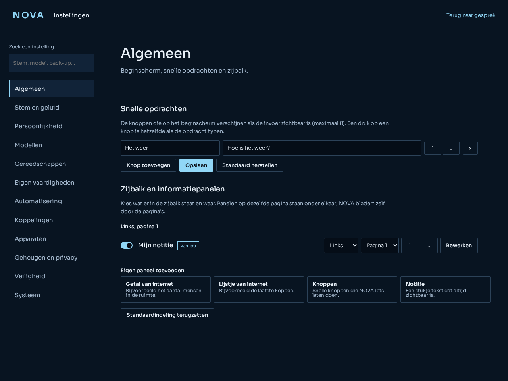     | 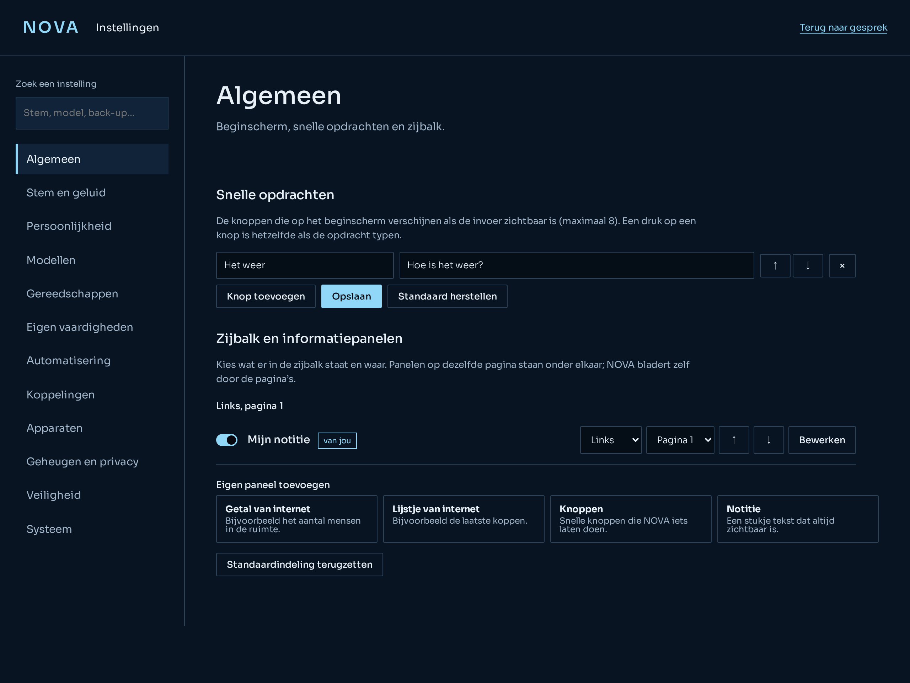     | 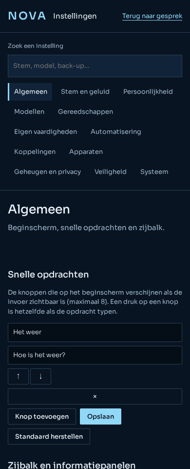     |
| Models      | 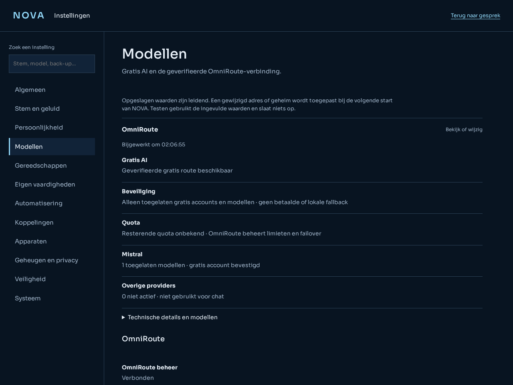      | 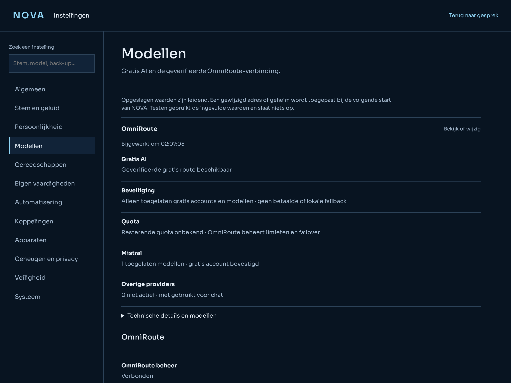      | 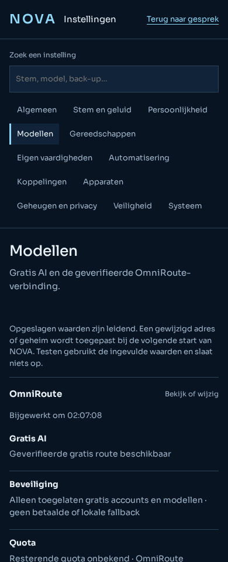      |
| Personality | 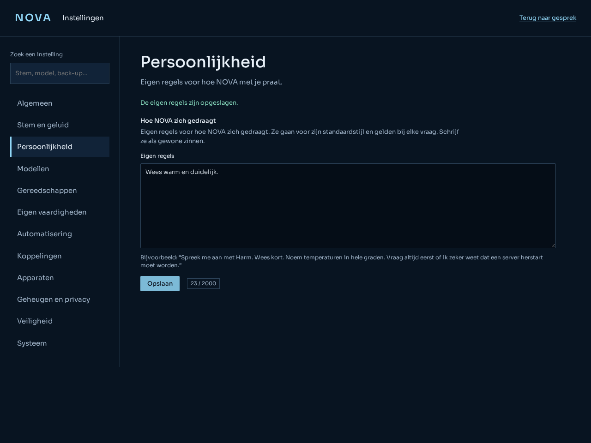 | 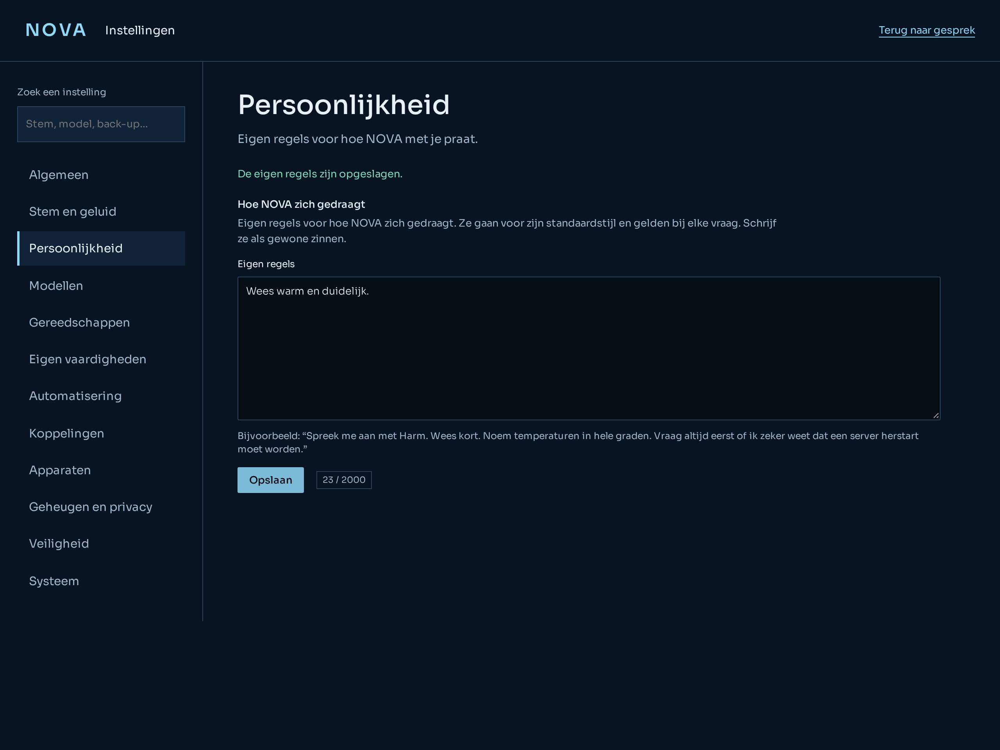 | 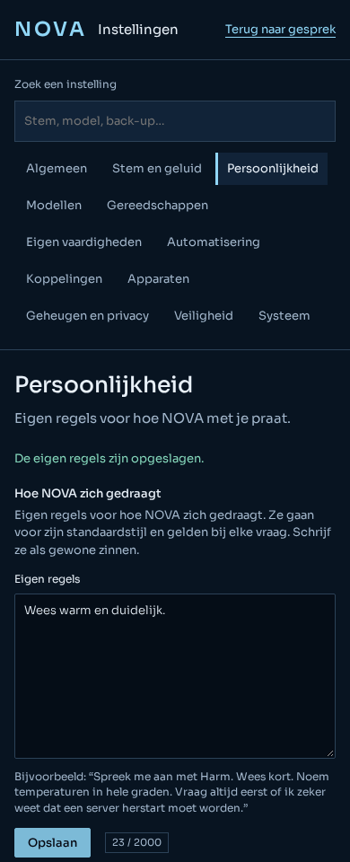 |

No real phone or Windows-PC test has been performed for this settings transition. Connection editors, bounded adapters and connection history are now implemented.
Onboarding, complete-system backups, service-specific controls and upstream account/model management remain later phase J work.

The Connections section has expandable service editors, secret-presence flags, an unsaved-input
test button and a saved-versus-running restart message. The System section provides selective
nonsecret rollback. Screenshots use fixture credentials, never actual connections.

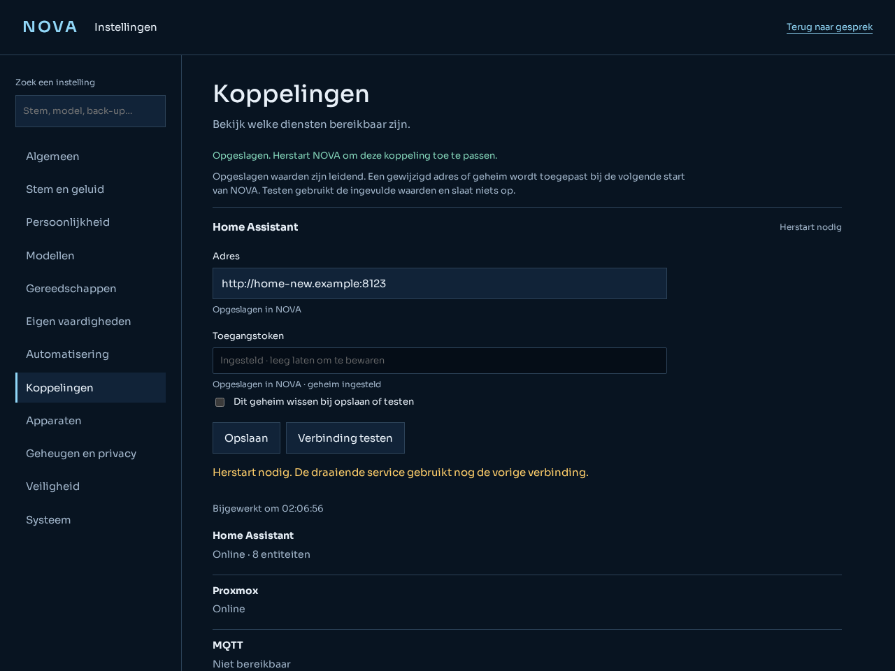
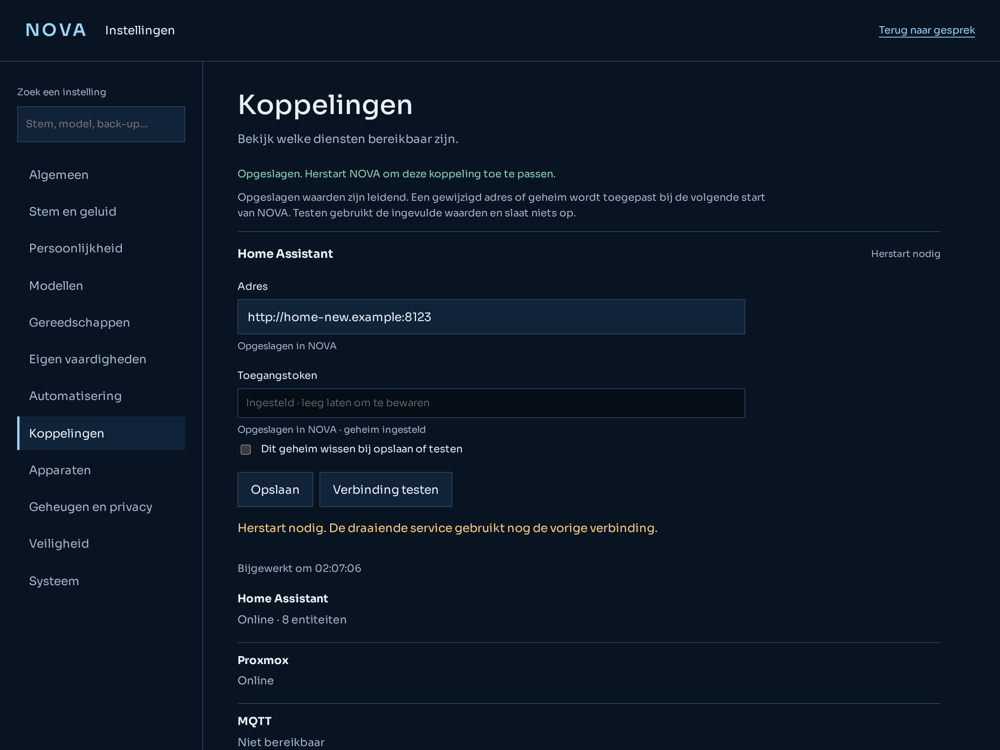
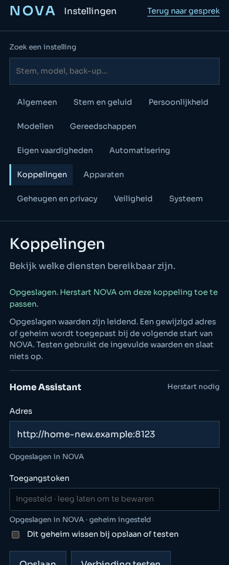
